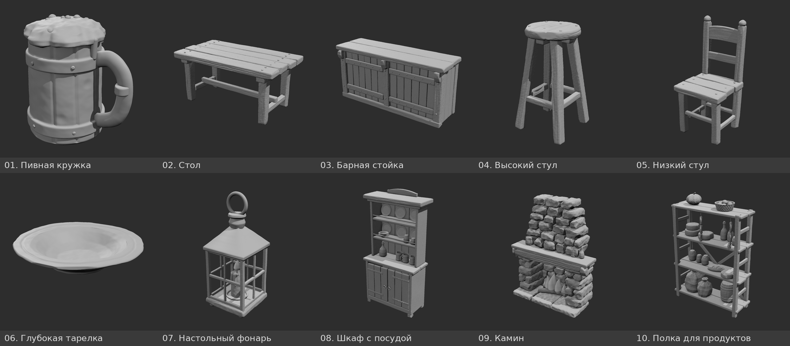

# Таверна: 10 предметов в стиле «ручной скульпт» (средневековье / D&D)

Серая «глина», мягкие фаски, сколы, волокна дерева, гвозди и заклёпки, как на референсе с полкой и ступкой.
Каждый предмет построен как настоящая 3D-модель и снят с 8 ракурсов в одинаковом студийном свете.



## Трейлер DICE

Трейлер короткометражки **DICE** (1920×1080, 1:18):

- **Смотреть / скачать, высокое качество (84 МБ):** [DICE_trailer.mp4](https://github.com/hammi-ko/tavern-props/raw/dice-trailer/trailer/DICE_trailer.mp4)
- **Облегчённая версия (35 МБ):** [DICE_trailer_light.mp4](https://github.com/hammi-ko/tavern-props/raw/dice-trailer/trailer/DICE_trailer_light.mp4)

## Скачать

- **FBX, лёгкая версия** (для игр и движков): [tavern_fbx_lite.zip](https://github.com/hammi-ko/tavern-props/raw/main/fbx/tavern_fbx_lite.zip)
- **FBX, полная детализация**: [tavern_fbx_full.zip](https://github.com/hammi-ko/tavern-props/raw/main/fbx/tavern_fbx_full.zip)
- **Всё сразу** (картинки, листы, модели): зелёная кнопка **Code** → **Download ZIP**

| № | Предмет | Лист со всеми ракурсами |
|---|---|---|
| 01 | Пивная кружка | [01_mug_sheet.png](sheets/01_mug_sheet.png) |
| 02 | Стол | [02_table_sheet.png](sheets/02_table_sheet.png) |
| 03 | Барная стойка | [03_bar_counter_sheet.png](sheets/03_bar_counter_sheet.png) |
| 04 | Высокий стул | [04_stool_high_sheet.png](sheets/04_stool_high_sheet.png) |
| 05 | Низкий стул | [05_chair_low_sheet.png](sheets/05_chair_low_sheet.png) |
| 06 | Глубокая тарелка | [06_deep_plate_sheet.png](sheets/06_deep_plate_sheet.png) |
| 07 | Настольный фонарь | [07_table_lantern_sheet.png](sheets/07_table_lantern_sheet.png) |
| 08 | Шкаф с посудой | [08_dish_cabinet_sheet.png](sheets/08_dish_cabinet_sheet.png) |
| 09 | Камин | [09_fireplace_sheet.png](sheets/09_fireplace_sheet.png) |
| 10 | Полка для продуктов | [10_pantry_shelf_sheet.png](sheets/10_pantry_shelf_sheet.png) |

## Что где лежит

| Папка | Что внутри |
|---|---|
| `sheets/` | листы-развёртки: все 8 ракурсов предмета на одной картинке с подписями (`01_mug_sheet.png` … `10_pantry_shelf_sheet.png`) |
| `renders/<предмет>/` | отдельные виды 1024×1024 на ровном сером фоне, их и загружать в нейросеть |
| `fbx/tavern_fbx_lite.zip` | **FBX, лёгкая версия** (10–250 тыс. треугольников): для игр и движков |
| `fbx/tavern_fbx_full.zip` | **FBX, полная детализация** (до ~680 тыс. треугольников): для рендера, запекания нормалей, печати |
| `models/<предмет>.glb` | сама 3D-модель (метры, низ на y = 0, перед смотрит в +Z), открывается в Blender, Unity, Unreal и в онлайн-просмотрщиках |
| `trailer/` | трейлер короткометражки DICE (`DICE_trailer.mp4` и облегчённая версия) |
| `src/`, `tools/` | код, которым всё сгенерировано |

Ракурсы: `01_front` спереди, `02_back` сзади, `03_left` слева, `04_right` справа, `05_top` сверху
(первые пять — ортографические, без перспективы, удобны как чертёж), `06_front_3q` 3/4 спереди,
`07_back_3q` 3/4 сзади, `08_low_3q` 3/4 спереди-слева с низкой точки.

## Предметы

| № | Предмет | Папка | Габарит (Ш×В×Г, м) | Что на модели |
|---|---|---|---|---|
| 01 | Пивная кружка | `mug` | 0.17×0.18×0.12 | деревянная из клёпок, два железных обруча с заклёпками, ручка с обоймой, шапка пены с потёками |
| 02 | Стол | `table` | 1.59×0.78×0.87 | четыре толстые доски столешницы, поперечины, квадратные ножки, проножки, шляпки гвоздей |
| 03 | Барная стойка | `bar_counter` | 2.32×1.10×0.76 | спереди: доски, столбы, накладные планки, кронштейны; сзади: полки бармена с кружками, бутылками и бочонками |
| 04 | Высокий стул | `stool_high` | 0.42×0.77×0.42 | круглое сиденье из досок, четыре разведённые ножки, кольцо подножки |
| 05 | Низкий стул | `chair_low` | 0.46×1.00×0.47 | сиденье из трёх досок, спинка с двумя перекладинами, навершия на стойках |
| 06 | Глубокая тарелка | `deep_plate` | 0.27×0.05×0.27 | широкий волнистый борт с канавкой, кольцевая ножка, сколы и вмятины |
| 07 | Настольный фонарь | `table_lantern` | 0.15×0.38×0.15 | кованый каркас, крыша-пирамида, кольцо для переноски, свеча с потёками и пламенем |
| 08 | Шкаф с посудой | `dish_cabinet` | 1.16×2.15×0.52 | тумба с дверцами, петлями и кольцами-ручками; сверху открытые полки с тарелками, мисками, кружками, кувшином и банками |
| 09 | Камин | `fireplace` | 1.95×2.32×0.85 | каменные пилоны, деревянная балка и каминная полка, сужающийся дымоход, дрова и пламя, свечи на полке |
| 10 | Полка для продуктов | `pantry_shelf` | 1.19×1.67×0.42 | стеллаж из брусков; мешки, бочонок, банки, хлеб, сыры, бутылки, колбасы на крючках, тыква, корзина яблок |

## FBX

Размеры реальные, единицы — сантиметры (стол 160 см, кружка 17 см). Ось Y вверх, перед объекта смотрит в +Z.
Каждый предмет разбит на отдельные детали (доски, гвозди, посуда), поэтому лишнее легко удалить.
Материал один, серый, без текстур и UV-развёртки. Перед текстурированием нужна развёртка (Smart UV Project в Blender) или ретопология.

## Как отправлять в нейросеть для 3D

- **Multi-view** (Meshy, Tripo, Hunyuan3D, Rodin): загружайте из `renders/<предмет>/` виды `01_front`, `04_right`, `02_back`, `03_left`. Если можно добавить ещё, то `06_front_3q`.
- **Одна картинка**: лучше всего работает `06_front_3q`.
- **Текстовая подсказка** (если сервис просит): `stylized hand-sculpted medieval fantasy tavern prop, chunky proportions, soft bevels, chipped edges, carved wood grain, D&D style, <предмет>`.
- У фонаря стёкол нет, каркас открытый. Если нужно стекло, добавьте его в подсказку.
- Можно обойтись без нейросети: в `models/` уже лежат готовые модели (.glb). Их можно сразу открыть, ретопологизировать и затекстурировать.

## Пересобрать

```bash
npm install                 # three.js
node tools/render.js        # все предметы (или: node tools/render.js mug table)
python3 tools/sheets.py     # листы-развёртки
node tools/to_fbx.mjs       # FBX (нужна утилита assimp: apt install assimp-utils)
```
